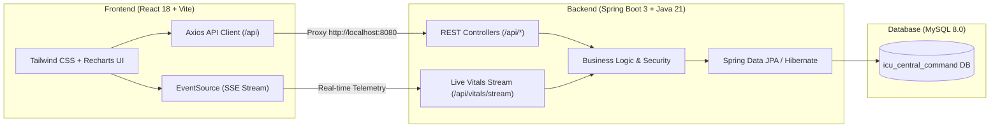

# ICU Central Command - Multi-Speciality Hospital System

A multi-speciality hospital ICU Central Command Workspace designed for real-time patient monitoring, ICU bed management, and clinical workflow coordination.

---

## Architecture Overview



---

## Connection & Port Details

| Component | Port | URL / Path | Notes |
| :--- | :--- | :--- | :--- |
| **Frontend** | `5173` | `http://localhost:5173` | React 18, Vite, Tailwind CSS, Lucide Icons |
| **Backend** | `8080` | `http://localhost:8080` | Spring Boot 3.2.3, Tomcat, Java 21 |
| **MySQL Database** | `3306` | `jdbc:mysql://localhost:3306/icu_central_command` | Credentials: `root` / `raja2207` |
| **Vite Dev Proxy** | - | `http://localhost:5173/api` &rarr; `http://localhost:8080/api` | Eliminates CORS issues in browser |

---

## Default Login Credentials

| Role | Username | Password | Default Landing Page | Permissions |
| :--- | :--- | :--- | :--- | :--- |
| **Admin** | `admin` | `Admin@123` | `/admin` (Command Center) | Full access to all wards, beds, users, analytics |
| **Doctor** | `doctor1` | `Doctor@123` | `/doctor` (Clinical Roster) | Assigned patients, clinical alerts, live vitals |
| **Nurse** | `nurse1` | `Nurse@123` | `/nurse` (Nurse Station) | Floor bed board, cleaning monitors, bed assignment |

---

## How to Run

### Quick Start (Windows)
Double-click `start-all.bat` to launch both servers, or run individually:
- **Backend**: Double-click `start-backend.bat`
- **Frontend**: Double-click `start-frontend.bat`

### Manual Commands

#### 1. Backend (Spring Boot)
```powershell
cd backend
java -jar target\icu-central-command-backend-1.0.0.jar
```
*Backend runs on `http://localhost:8080`.*

#### 2. Frontend (Vite)
```powershell
cd frontend
npm run dev
```
*Frontend runs on `http://localhost:5173`.*

---

## API Endpoints Reference

- **Authentication**: `POST /api/auth/login`
- **Dashboard Metrics**: `GET /api/dashboard`
- **Doctor Workspace**: `GET /api/doctor/dashboard?username=doctor1`
- **Nurse Station**: `GET /api/nurse/dashboard?username=nurse1`
- **Beds Matrix**: `GET /api/beds`, `PUT /api/beds/{id}/status`, `POST /api/beds`, `DELETE /api/beds/{id}`
- **Patients Directory**: `GET /api/patients`, `GET /api/patients/{id}/details`, `POST /api/patients`
- **Bed Assignments**: `POST /api/bed-assignments`, `POST /api/bed-assignments/beds/{bedId}/release`
- **Wards Overview**: `GET /api/wards`, `GET /api/wards/availability`
- **Doctors Roster**: `GET /api/doctors`, `POST /api/doctors`
- **Operational Alerts**: `GET /api/alerts`, `PUT /api/alerts/{id}/read`
- **Live Vitals & SSE**: `GET /api/vitals/live`, `GET /api/vitals/stream` (Server-Sent Events)
- **User Accounts**: `GET /api/users`, `POST /api/users`, `PUT /api/users/{id}`, `PUT /api/users/{id}/status`
